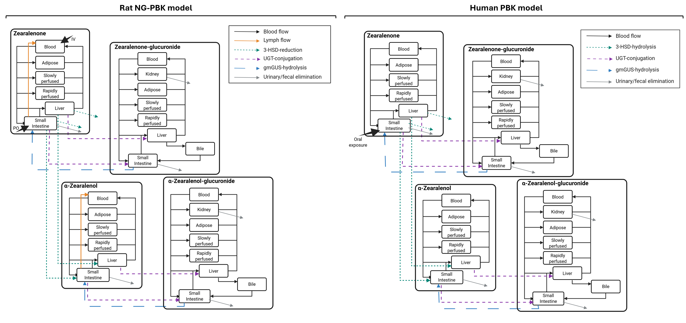

# Zearalenone and metabolites NG-PBK model

This repository contains all the work related to the publication: "Use of a mechanistic physiologically based kinetic model and quantitative in vitro to in vivo extrapolation to evaluate the tolerable daily intake of zearalenone", to access the pre-print follow this [link](DOI:%2010.21203/rs.3.rs-10804586/v1).

The repository has 3 main folders:

**Input:** containing all files needed to run the scripts

**Script:** containing all code files

**Output:** where results are stored

## Model implementation

The repository contains NG-PBK models predicting the internal concentrations of zearalenone, $\alpha$-zearalenol, zearalenone-glucuronide and $\alpha$-zearalenol-glucuronide in rats and humans. A schematic representation of the models in rat and human can be found in Figure 1.

 Figure 1. schematic representation of the rat and human NG-PBK models.

### To run the human NG-PBK model

Use: **DO_ZEN_PBK_Human.R**

These files located in the Input folder will be automatically loaded when running the script:

- PhysioVariables.csv, containing the physiological parameters in humans per age

- TissueComposition.csv, containing the tissue composition in humans

- PhysChem.csv, containing the physicochemical properties of zearalenone and its metabolites

The "**RUN_and_OUTPUT_Human.R**" script located in the Script folder will be automatically loaded

- RUN_and_OUTPUT_Human.R, contains the script for adding the initial amounts in each compartment, calculating mass balance and ploting model predictions. It will automatically load the script containing the human PBK model (**PBK_model_Human.R**) and the script for calculating the PBK model parameters (**CALC_Parameters_Human.R**), both of which are located in the Script folder.

### To run QIVIVE for humans

Use: **QIVIVE_Human.R**

The file loads the model parameters for an average adult (30-old) female (**Parameters_Human.csv** located in the Input folder) and the human PBK model script **PBK_model_4GSA_4QIVIVE_Human.R** located in the Script folder.

### To run the rat NG-PBK model

Use: **PBK_model_Rat.R**

These files located in the Input folder will be automatically loaded when running the script:

- TissueComposition.csv, containing the tissue composition in humans

- PhysChem.csv, containing the physicochemical properties of zearalenone and its metabolites

- GoodnessOfFit_Rat.csv, containing the evaluation data from the *in vivo* toxicokinetic rat studies

### To run sensitivity analysis for the human and rat NG-PBK model

Use the files: **Morris_Rat.R & eFAST_Rat.R / Morris_Human.R & eFAST_Human.R**

The PBK model code used with these scripts are: **PBK_model_4GSA_Rat.R** and **PBK_model_4GSA_4QIVIVE_Human.R**

All input parameters are evaluated in Morris, these are loaded from **Parameters_Rat.csv** and **Parameters_Human.csv.**

Only the most highly ranked parameters are evaluated in eFAST, these are loaded from **Parameters_toeFAST_Rat.csv** and **Parameters_toeFAST_Human.csv.**

## Required packages

here, tidyverse, deSolve, readr, sensitivity, ggrepel, scales, patchwork, PKNCA, pracma, readxl, purrr
